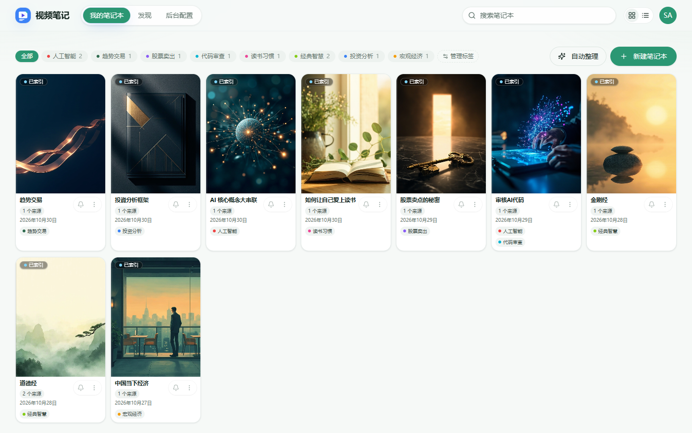

# video-notebook

把视频变成可检索、可对话、可产出的**知识笔记本**（NotebookLM 风格，偏内部使用）。



系统架构见 [架构](docs/architecture.md)。

## 核心能力

- **笔记本与来源** — URL / 上传入库，字幕与概览；网页搜索（B 站 / YouTube）加片
- **标签** — Chip 筛选、管理标签、AI 自动整理
- **对话** — 勾选来源问答，引用回到字幕时间点
- **知识底稿** — 抽要点，一键生成思维导图 / 幻灯片
- **发现** — 站内关键词与语义检索；笔记本可公开
- **管理后台** — 模型、抓取与网络、向量、账号与观测

细节见 [功能说明](docs/features.md)、[需求](docs/requirements.md)。

## 快速开始（本地）

```bash
cp .env.example .env   # 改掉默认密码与密钥
make middleware        # MySQL / Redis / Qdrant（本机端口）
cd api && uv sync && cd ..
cd web && npm install && cd ..
make migrate
make api               # :8000
make web               # :5173
make media-worker      # 抓取 / 字幕 / 向量
make worker            # 导图 / PPT（需本机 Claude CLI）
```

- Web：http://127.0.0.1:5173  
- API：http://127.0.0.1:8000/docs  

首次登录用 `.env` 的 `SEED_ADMIN_*`。完整步骤与前置：[本地部署与开发](docs/development.md)。

> 全栈 Docker Compose 部署稍后补充；当前以本地进程为主。

## 文档

| 文档 | 内容 |
|------|------|
| [功能说明](docs/features.md) | 现行能力 |
| [架构](docs/architecture.md) | 组件与数据流 |
| [本地部署与开发](docs/development.md) | 中间件、进程、环境变量 |
| [需求](docs/requirements.md) | 产品范围与边界 |
