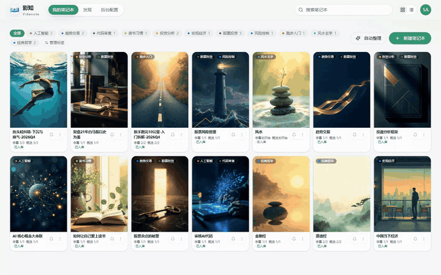

# 视频笔记本

> 从视频里学习和吸收知识

[**产品预览**](#-产品预览) · [**功能特性**](#-功能特性) · [**文档**](#-文档)

## 🖥️ 产品预览

## ✨ 功能特性

| 能力 | 覆盖内容 |
|------|------|
| 多端接入 | PC 网页、对外 Agent、微信小程序 |
| 分析 | 字幕与概览；按来源对话并跳回时间点；知识底稿，以及思维导图、幻灯片、阅读页 |
| 采集 | 哔哩哔哩与 YouTube 可搜索；这两者加上抖音也可用链接入库 |

> 各端用法见 [功能说明](docs/features.md)，三条平台如何入库见 [采集说明](docs/collection.md)。

## 📄 文档

| 文档 | 内容 |
|------|------|
| [功能](docs/features.md) | PC、对外 Agent、微信小程序各自能做什么 |
| [采集说明](docs/collection.md) | 哔哩哔哩、YouTube、抖音如何搜索与入库 |
| [架构](docs/architecture.md) | 组件与数据流 |
| [本地部署与开发](docs/development.md) | 本机进程、中间件与环境变量 |
| [需求](docs/requirements.md) | 产品范围与当前边界 |
