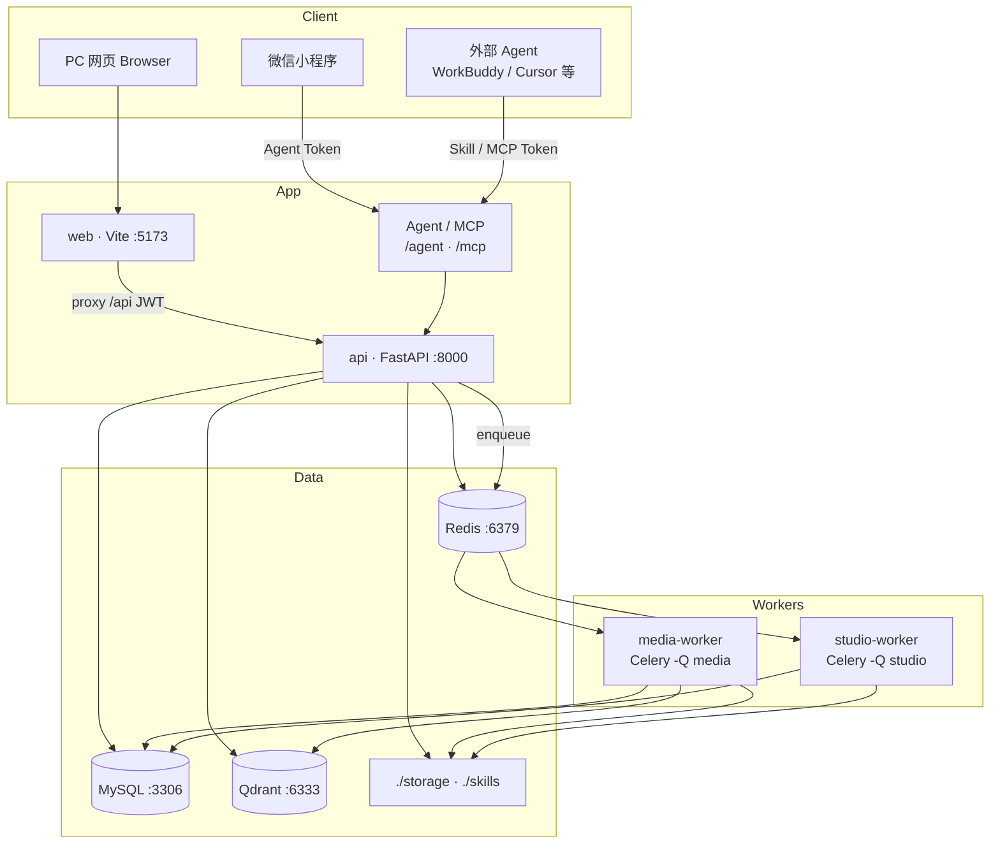
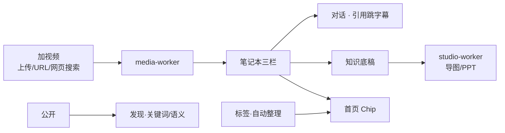

# 架构

以当前仓库代码为准。

## 总览

本地开发时：PC 浏览器打 Vite（`:5173`），`/api` 代理到本机 FastAPI（`:8000`）。微信小程序与外部 Agent 走 `/agent/*` + `/mcp`（Agent Token）。MySQL / Redis / Qdrant 用 `make middleware` 起在本机端口。

## 组件

| 组件 | 职责 |
|------|------|
| **web** | React + Vite；PC 完整工作台；开发期 `:5173`，代理 `/api` → api |
| **miniapp** | 微信小程序（Taro）；收集入口；调 Agent API |
| **api** | FastAPI：鉴权、笔记本/来源/标签、聊天 SSE、知识底稿、发现检索、入队 |
| **Agent / MCP** | /agent/* + /mcp：Token 鉴权的工具门面（search / notebook / readiness / draft）；Skill 由 /agent/skill.md 下发 |
| **media-worker** | 抓取、字幕、向量索引（`-Q media`） |
| **studio-worker** | 思维导图 / PPT（`-Q studio`，依赖本机 Claude CLI） |
| **MySQL** | 业务库（含 `tags` / `notebook_tags`） |
| **Redis** | 缓存 `db0`；Celery broker/result `db1`/`db2` |
| **Qdrant** | 语义检索 |
| **本地盘** | `STORAGE_ROOT=./storage`，`SKILLS_ROOT=./skills` |

## 主业务路径

1. PC 浏览器访问 web（API 经代理）；小程序 / 外部 Agent 经 Agent 门面；笔记本数据同一套。
2. 抓取 / ASR / 索引 / 导图 PPT 走 Celery，api 立即返回任务状态。
3. 标签存在 MySQL；自动整理只落库有关联的标签。
