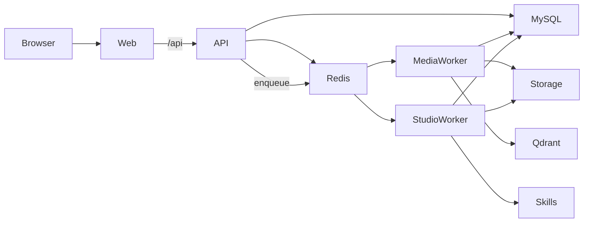

# 架构（现状）

> 以仓库当前代码为准。早期设计文档里的「单 worker / MinIO」等描述已过时，以本文为准。

## 组件

| 组件 | 职责 |
|------|------|
| **web** | Vite + React；开发期 `:5173`，Compose 下 nginx `:8080`，反代 `/api` |
| **api** | FastAPI；鉴权、CRUD、入队、聊天 SSE；`:8000` |
| **media-worker** | Celery `-Q media`：URL 抓取、字幕、向量索引 |
| **studio-worker** | Celery `-Q studio`：思维导图 / PPT 等 |
| **MySQL 8** | 业务元数据 |
| **Redis** | 会话/缓存 `db0`；Celery broker `db1`；result `db2` |
| **Qdrant** | 语义检索向量库（地址多在后台「向量配置」） |
| **LocalFsStorage** | 内容寻址本地盘（`STORAGE_ROOT` / `SKILLS_ROOT`），**无 MinIO** |

## 请求与任务流

1. 浏览器只打 Web；生产由 nginx 把 `/api/` 转到 api。
2. 耗时工作（抓取、ASR、索引、Studio）一律入 Celery，api 立即返回任务状态。
3. 媒体文件与产物写在本地 `STORAGE_ROOT`；Studio 技能文件在 `SKILLS_ROOT`。

## 与旧设计的差异（摘要）

- Worker 拆成 **media** / **studio** 两个队列与进程，不再是单一 `app.tasks` worker。
- 对象存储为 **本地文件系统**，不是 MinIO。
- 语义检索依赖 **Qdrant**（可在后台改 URL）。
