# 功能说明

按当前实现介绍 **影知 / Videnote**。三条入口共用同一套笔记本数据。产品边界见 [需求](requirements.md)，视频如何入库见 [采集说明](collection.md)，本地怎么跑起来见 [本地部署与开发](development.md)。

## PC

PC 网页（`web/`）是完整工作台：建笔记本、加入来源、对话、整理标签、生成知识底稿和产物，以及发现与管理后台。

### 笔记本与来源

- **笔记本**：创建、列表、置顶、公开、删除；可生成封面。打开后是三栏：来源、对话、知识 / 产物。
- **来源**：本地上传；粘贴链接（哔哩哔哩、YouTube、抖音，以及直链媒体文件）；在笔记本里**网页搜索**哔哩哔哩 / YouTube 后点「加入」。抖音没有关键词搜索。
- **字幕与概览**：抓取完成后出字幕，并可由模型写概览。未完成的链接可以「重新抓取」。

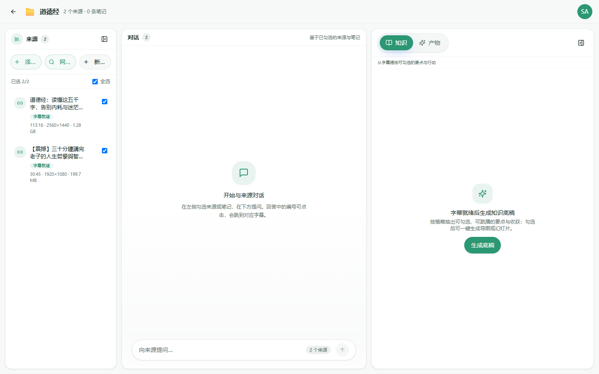

*笔记本内：左栏来源、中栏对话、右栏知识 / 产物。*

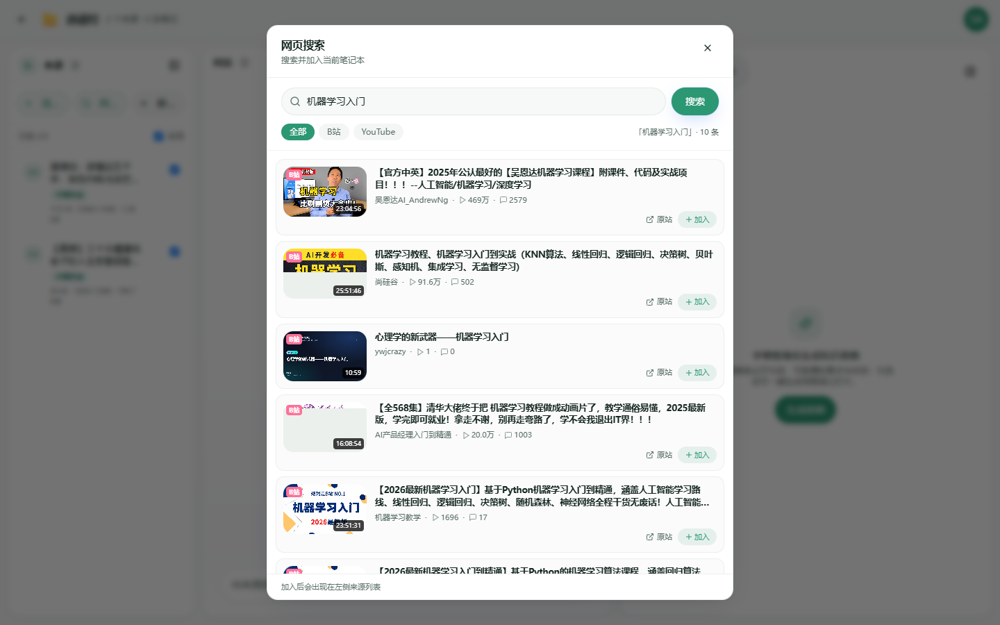

*网页搜索：按关键词搜哔哩哔哩 / YouTube，点「加入」入库。*

Cookie、代理和抖音解析在 **后台配置 → 内容流水线 → 网络**。

### 标签

- 标签与笔记本多对多。首页用 Chip 筛选，不展示关联数为 0 的标签。
- **管理标签**：手建、改名、改色、删除。
- **自动整理**：按名称和描述生成方案，确认后覆盖关联；不落库空标签。

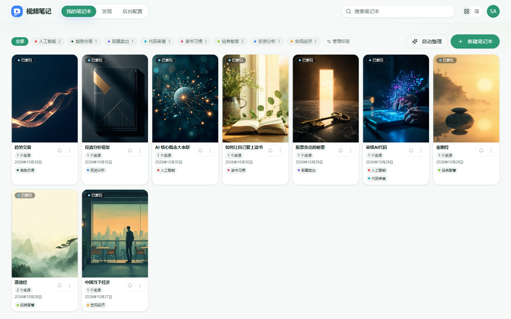

*首页：标签筛选、自动整理、笔记本卡片。*

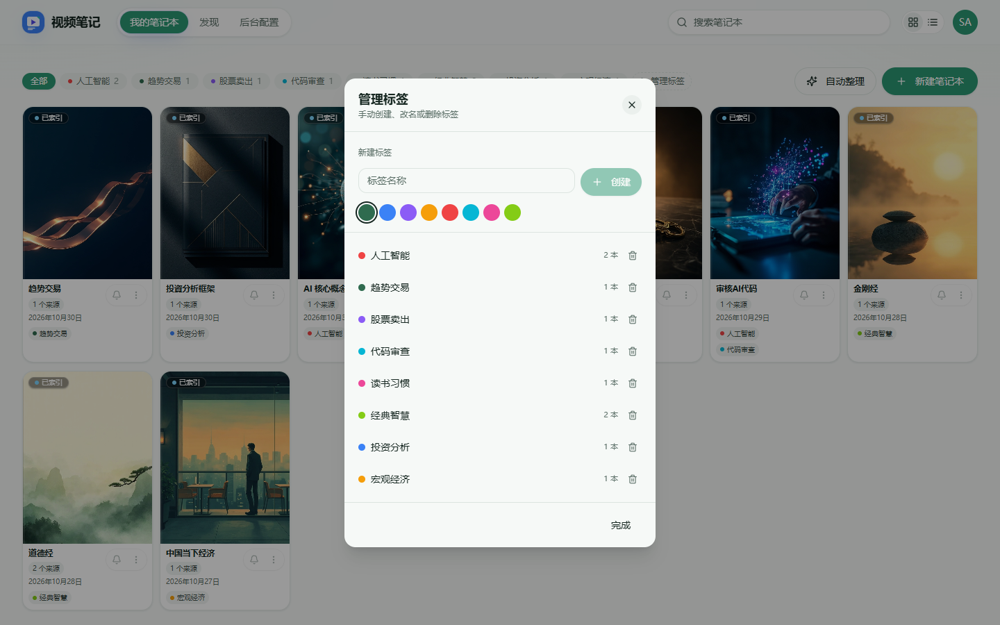

*管理标签：创建、配色、删除。*

### 对话

只用左栏**勾选**的来源作上下文，历史轮数可在后台配置。回答可以带引用，点引用回到字幕时间点，也可以存成笔记。

对话区见上面的笔记本三栏中栏。

### 知识底稿与产物

- **知识底稿**：字幕就绪后，按后台策略从勾选来源抽要点（可配策略与 `max_tokens`）。界面提示「字幕就绪后生成知识底稿」。
- **思维导图、幻灯片、阅读页**：勾选要点后生成，由 studio-worker 完成（本机需有 Claude CLI）。

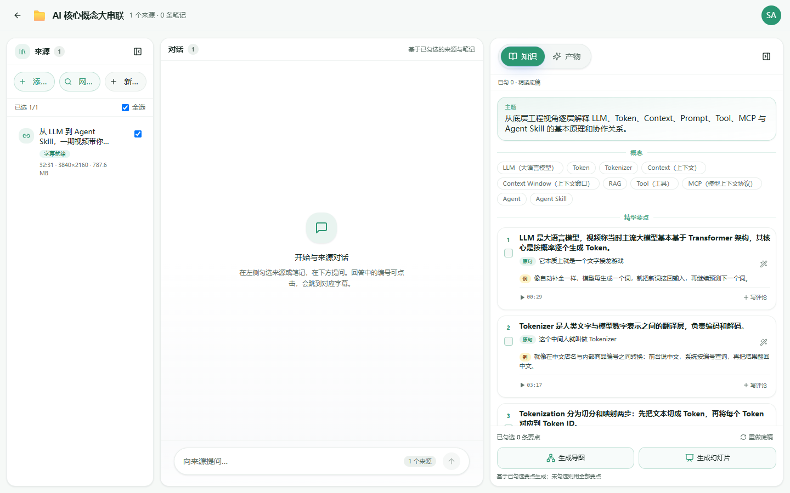

*知识底稿：概念标签、可勾选要点，可继续生成导图、幻灯片或阅读页。*

### 发现

检索范围可以是全部、我的或公开笔记本，支持关键词和语义检索（Qdrant）。笔记本设为公开后会出现在发现里。

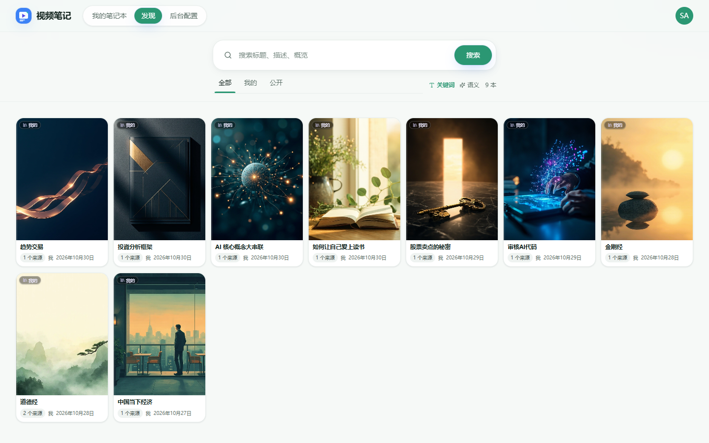

*发现：检索公开笔记本和我的笔记本。*

### 账号与后台

- 账号由管理员创建。登录用手机号和密码。角色分用户和管理员，没有自助注册。
- **后台配置**：模型（对话 / 语音转文字）、抓取与网络、抓取并发与超时、向量、底稿策略、账号、运行观测（流水线 / LLM 调用）。
- **设置 → Agent 接入**：创建给外部 Agent 和微信小程序用的 Token。见下文。
- 健康检查：`GET /api/health`、`GET /api/health/ready`。

## 对外 Agent

把影知接到 WorkBuddy、Claude Code、Cursor 等客户端。用 **Agent Token + Skill + MCP**，不要把整站 `/api` 或登录 JWT 交给 Agent。

Token 在网页 **设置 → Agent 接入** 创建，形如 `vn_agent_…`，请求头为 `Authorization: Bearer`。明文只显示一次，可以撤销。

### 能做什么

| 能力 | 说明 |
|------|------|
| 搜索视频 | `search`：YouTube / 哔哩哔哩。不支持抖音关键词搜索 |
| 笔记本 | `create_notebook` / `list_notebooks` / `get_notebook` / `delete_notebook` |
| 加片入库 | `add_url` 后异步抓取；`get_readiness` 看字幕是否就绪 |
| 知识底稿 | 用户明确要求，且 `ready_for_draft = true` 之后才 `generate_draft` |
| 读取产物 | `get_draft` 读知识正文；`list_artifacts` / `get_artifact`；`download_video` 用签名 URL |
| 标签 | `list_tags`，并可配合自动归类 |

`ready_for_draft` 表示笔记本里**全部**来源的字幕都已就绪。只要还有来源在抓取，或字幕尚未就绪，生成底稿会被拒绝。

**默认先搜索再停步。** 用户只说「搜一下」时，Agent 只搜索并汇总，然后停下。建笔记本、加入链接、生成底稿，都要用户再说一次。不要把「搜索 → 入库 → 生成底稿」串成一条自动流水线。

权限大致分为：`read`（搜和读）、`write_notebook`（建本、加链接）、`write_generate`（封面、底稿）。媒体只通过签名 URL 下载，工具结果里不带视频或图片二进制。

公开入口：`/agent/skill.md`、`/mcp`、`/agent/v1/tools/<name>`、`/llms.txt`、`/agent/install.sh`。

### 接入与使用

1. **创建 Token，把安装命令交给当前客户端。**  
   在 **设置 → Agent 接入** 创建 Token。把安装命令发给正在使用的客户端（WorkBuddy / Claude Code / Cursor 等），由**该客户端里的 Agent**按本客户端的规范自行安装 Skill 和 MCP。不要假定一定要写进 `~/.cursor/mcp.json`。

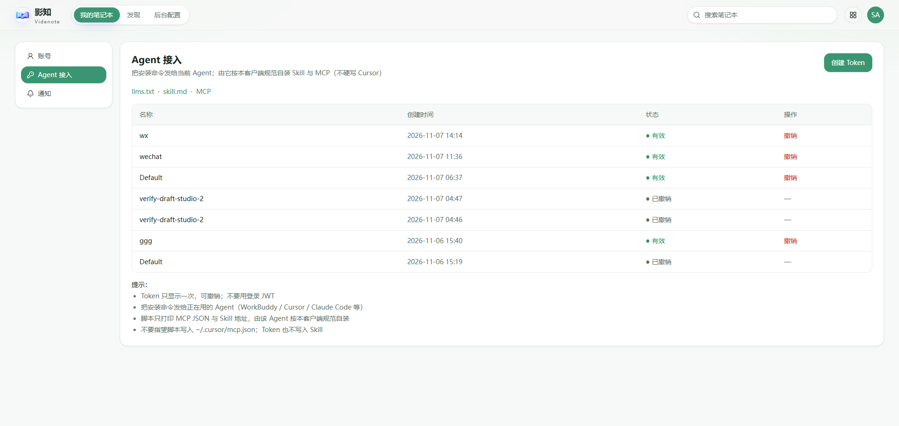

*图 1 · 设置 → Agent 接入：创建 Token，下发安装命令；可查看 `llms.txt` / `skill.md` / MCP。*

2. **先搜索，然后停下。**  
   Skill / MCP 就绪后，用自然语言让 Agent 搜片。它应只调用搜索、整理标题和链接，等你指定要入库的条目。

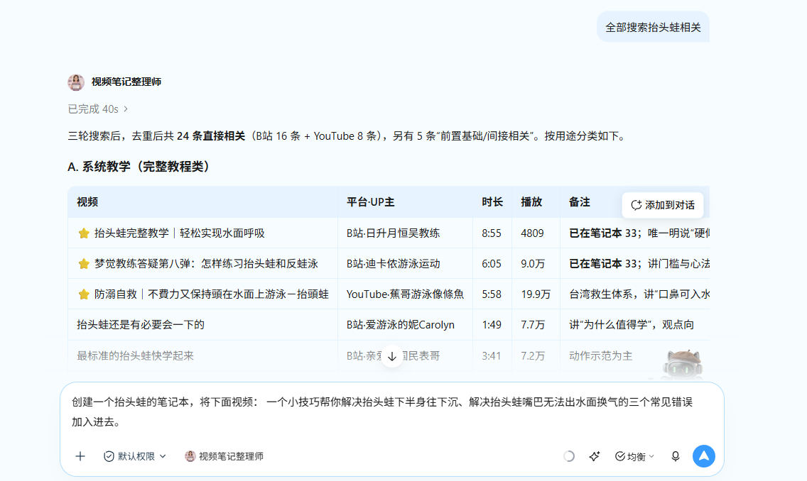

*图 2 · 按主题搜索并分类列出结果；备注可以标出已经在某个笔记本里的片。*

3. **明确要求后再创建笔记本、加入链接。**  
   例如：「创建一个笔记本，把下面这两条加入」。Agent 再调用 `create_notebook` 和 `add_url`。

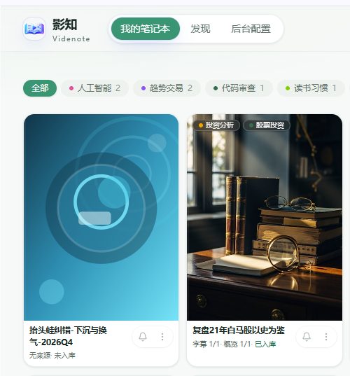

*图 3 · 网页「我的笔记本」：Agent 创建的笔记本已经出现（封面可能仍在生成）。*

4. **链接会自动开始抓取。**  
   加入的 URL 进入抓取和字幕流水线。网页来源栏可以看到抓取与「字幕就绪」等状态。任一来源还在抓取时，不要生成底稿。

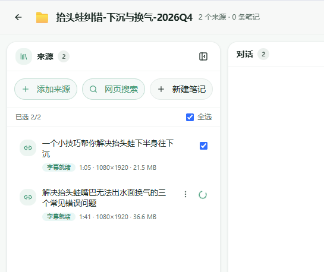

*图 4 · 笔记本详情：来源已加入并抓取；字幕就绪后才能生成底稿。*

5. **全部就绪后，再要求生成底稿。**  
   当 `ready_for_draft = true`，在客户端说「生成知识底稿」。Agent 会创建与网页相同的底稿任务；用 `get_job` 看进度，成功后用 `get_draft` 读正文。

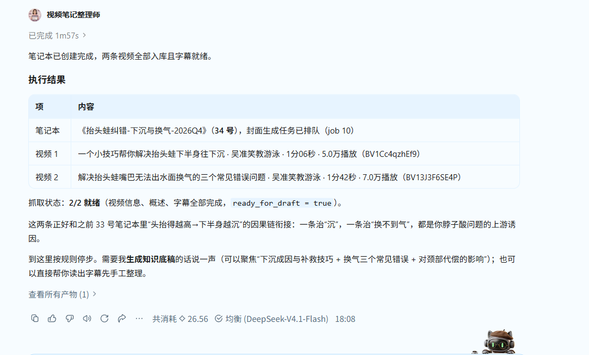

*图 5 · 抓取全部就绪后按规则停步，询问是否生成知识底稿。*

本页是对外 Agent 的产品说明。旧链接 [agent.md](agent.md) 只保留入口，不再重复这份步骤。

## 微信小程序

微信小程序（`miniapp/`）是手机上的收集入口：把分享文案贴进来，抽出链接，新建或加入笔记本，然后由后端抓取。笔记本与 PC、对外 Agent 互通，走同一套 Agent API（`POST {server}/agent/v1/tools/<name>`），请求头同样是 `Authorization: Bearer vn_agent_…`。

当前定位是**内网、开发或体验入口**。AppID `wx807def5a62c2af59` 用于开发者工具或体验版，不必正式上架。编译、开发者工具和连接项见 [miniapp/README.md](../miniapp/README.md)；链接进笔记本之后的抓取见 [采集说明](collection.md)。

### 页面

| Tab / 页 | 作用 |
|----------|------|
| 笔记本 | 双列封面、搜索、标签筛选、自动归类、左滑删除、进入详情 |
| 收集 | 粘贴分享文案，抽出链接，新建或加入笔记本 |
| 我的 | 连接设置：Server URL、Agent Token |
| 详情 | 封面、相关视频与抓取状态、底稿步骤；字幕就绪后可重新生成底稿或下载 |

Server 要填手机或模拟器能够访问的后端地址，不要填本机 `localhost`。Token 在网页 **设置 → Agent 接入** 创建。

### 收集一条抖音视频

演示以抖音分享文案为例。收集页抽出的是文案里的第一个 http(s) 链接，哔哩哔哩、YouTube 链接也可以贴进来，只要后端能抓。

1. 在抖音里打开要记的视频，点 **分享**。分享面板里可以找到小程序 **影知**，或先 **复制链接**。若分享面板还没有挂上影知，复制分享文案后手动打开影知，切到底部 **收集**。
2. 把整段分享文案贴进「粘贴分享文案」。小程序识别出其中的链接（抖音短链一般是 `v.douyin.com`）后，点 **收集**。

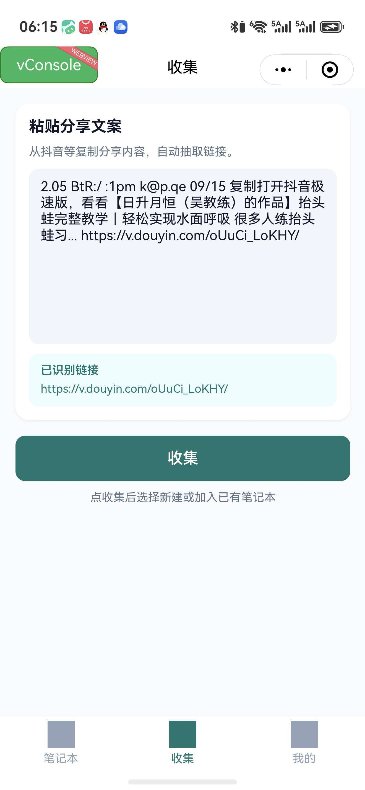

*图 1 · 收集：粘贴抖音分享文案，展示已识别的链接。*

3. 底部面板里选择去向：
   - **新建笔记本**（名称可留空，按文案自动命名），点「新建并收集」。
   - **最近**：加入最近用过的本。
   - **搜索全部**：从更多笔记本里选。

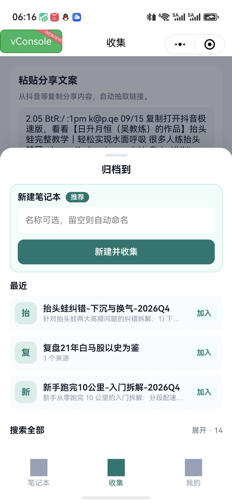

*图 2 · 归档：新建并收集，或加入最近的笔记本。*

4. 打开该笔记本后，视频会显示封面和状态（例如 `ready`、`probing`）。字幕就绪后，详情里可以看到底稿步骤，也可以重新生成底稿或下载。

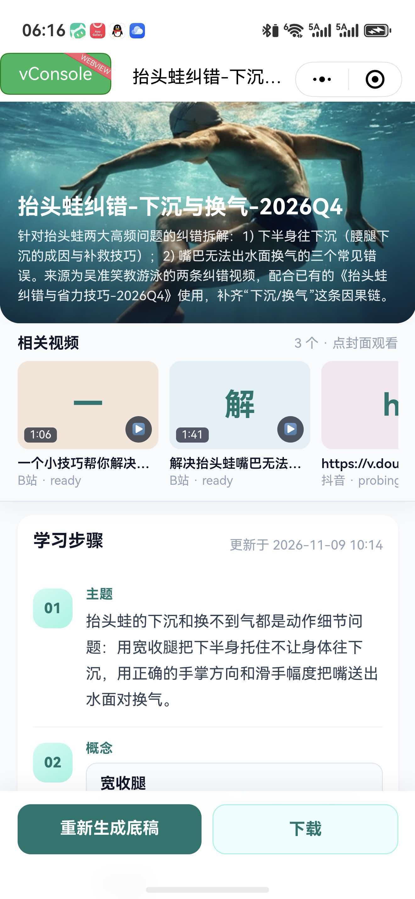

*图 3 · 详情：已有来源为 ready，新加的链接处于 probing（抓取中）；下方为底稿步骤。*

5. 底部 **笔记本** Tab 是双列封面墙，可搜索、按标签筛选、自动归类；**左滑可删除**。

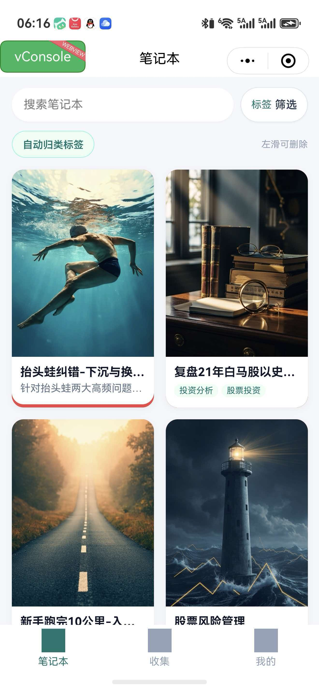

*图 4 · 笔记本列表：双列封面，左滑删除。*
