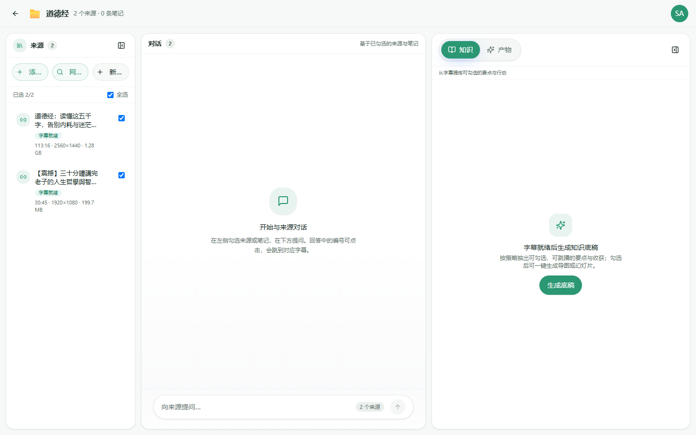
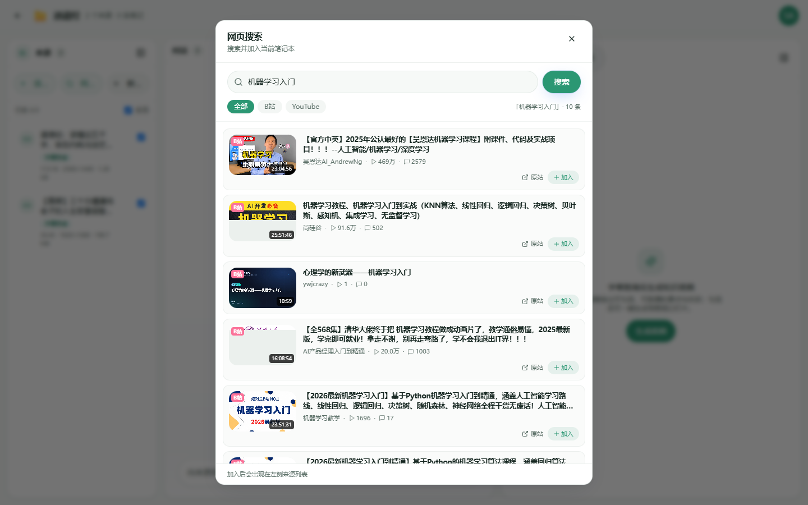
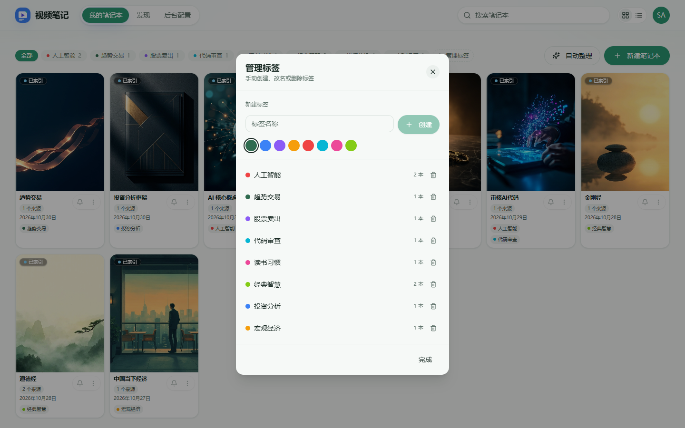
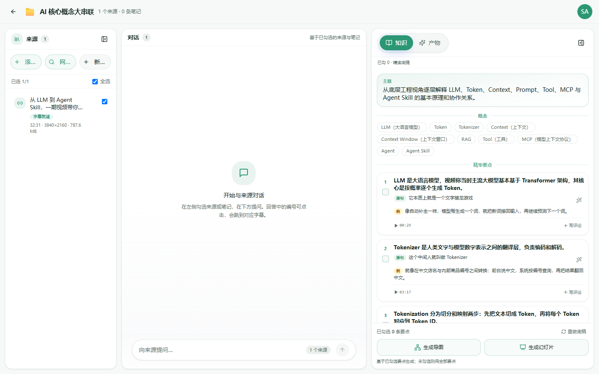
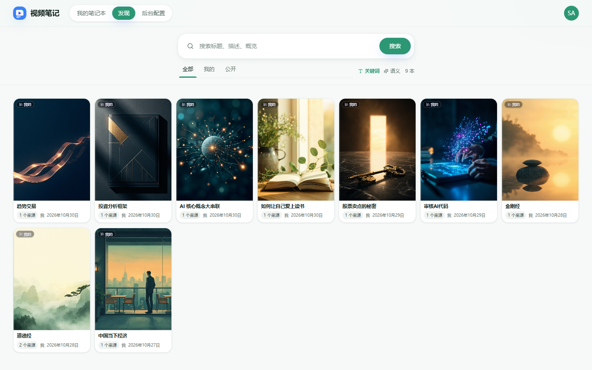

# 功能说明

按**当前实现**介绍。产品边界见 [requirements.md](requirements.md)。

## 笔记本与来源

- **笔记本**：创建 / 列表 / 置顶 / 公开 / 删除；封面；打开后三栏（来源 · 对话 · 知识/产物）。
- **来源**：本地上传；粘贴 URL（YouTube / 直链等，yt-dlp）；笔记本内**网页搜索**（B 站 / YouTube）加入。
- **字幕**：内嵌 → 平台字幕 → ASR；可重试。
- **概览**：默认 LLM 生成。

*笔记本内：左栏来源、中栏对话、右栏知识/产物。*

*网页搜索：按关键词搜 B 站 / YouTube，点「加入」入库。*

Cookie / 代理在 **后台 → 抓取与网络** 按平台配置。

## 标签

- 多对多挂在笔记本；首页 Chip 筛选（不展示关联数为 0 的标签）。
- **管理标签**：手建 / 改名 / 删。
- **自动整理**：据名称与描述生成方案，确认后覆盖关联；不落库空标签。

*首页：标签筛选、自动整理、笔记本卡片。*

*管理标签：创建、配色、删除。*

## 对话

- 只用左栏**勾选**来源作上下文；可配历史轮数。
- 回答可带引用，能回到字幕时间点；可存笔记。

（对话区见上图笔记本三栏中栏。）

## 知识底稿与产物

- **知识底稿**：字幕就绪后按策略抽要点（后台可配策略与 `max_tokens`）。
- **思维导图 / 幻灯片**：勾选要点后入队，由 studio-worker 生成（需 Claude CLI）。

*知识底稿：概念标签、可勾选要点，可生成导图 / 幻灯片。*

## 发现

- 站内范围：全部 / 我的 / 公开。
- 关键词与语义检索（Qdrant）。

*发现：检索公开/我的笔记本。*

## 账号与后台

- 账号由管理员创建；手机号 + 密码；角色：用户 / 管理员。
- 后台：模型（LLM/ASR）、抓取与网络、向量、底稿策略、账号、运行观测（流水线 / LLM traces）等。
- 健康检查：`GET /api/health`、`GET /api/health/ready`。
