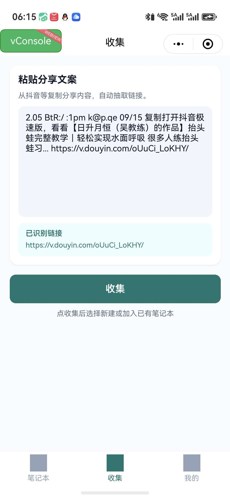
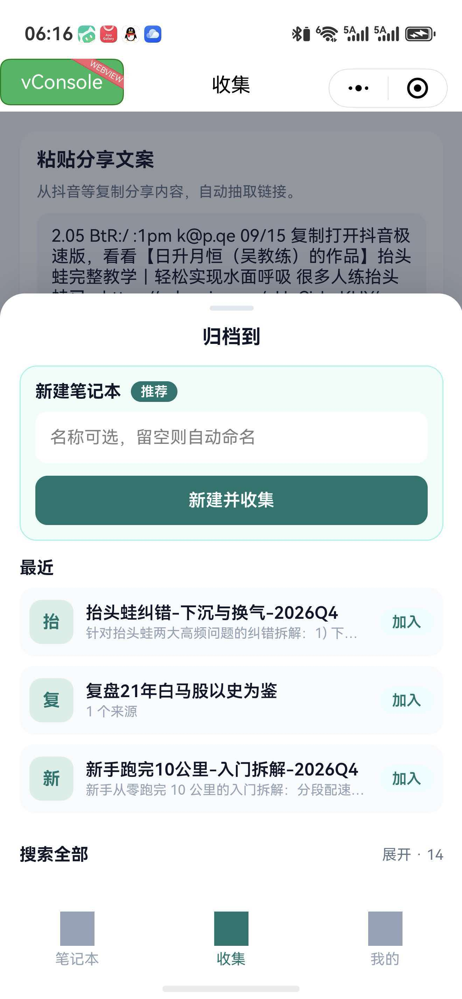
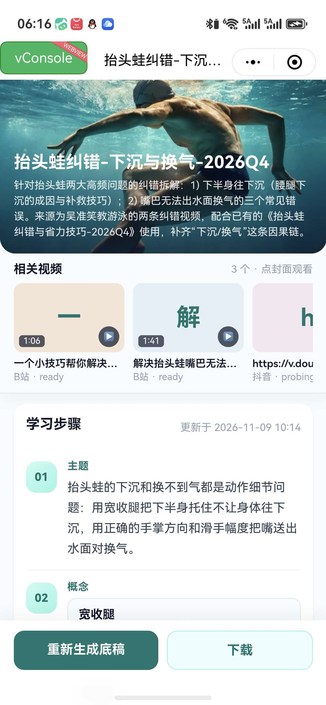

# 微信小程序 · 影知（Videnote）

手机端收集入口：把抖音等平台的分享文案粘进小程序，抽链后新建或加入笔记本，后端自动抓取并生成字幕 / 底稿。开发说明见 [`miniapp/README.md`](../miniapp/README.md)。产品总览见 [features.md](features.md)。

当前定位：**内网 / 体验版方便入口**（开发者工具或体验版即可，不必正式上架）；需在「我的 / 连接设置」填好可访问的 Server 与 Agent Token。

## 演示：抖音视频进笔记本

### 1. 在抖音里分享并打开影知

1. 打开抖音，找到要记的视频，点 **分享**。
2. 在分享面板里 **下拉**，找到小程序 **影知**（或先 **复制链接**）。
3. 进入影知后切到底部 **收集** Tab。

（若分享面板暂未挂上影知，可复制分享文案，再手动打开影知 → 收集。）

### 2. 粘贴分享文案，自动抽链

在「粘贴分享文案」框里粘贴抖音复制出来的整段文字；小程序会识别出其中的 `v.douyin.com` 链接。确认无误后点 **收集**。

*图 1 · 收集：粘贴抖音分享文案，展示「已识别链接」。*

### 3. 新建笔记本，或加入已有本

点收集后弹出底部面板：

- **新建笔记本**（推荐）：名称可留空自动命名，点「新建并收集」。
- **最近**：一键「加入」最近用过的本。
- **搜索全部**：从更多笔记本里选。

*图 2 · 归档到：新建并收集，或加入最近笔记本。*

### 4. 开始抓取，详情里看进度

入库后打开该笔记本：相关视频会出现封面与状态（如 `ready` / `probing`）。抖音源会走抓取流水线；字幕就绪后可在详情看学习步骤（底稿），也可「重新生成底稿」或「下载」。

*图 3 · 详情：B 站来源已 ready，新加的抖音链接处于 probing（抓取中）；下方为底稿学习步骤。*

### 5. 回笔记本列表管理

底部 **笔记本** Tab 为双列封面墙：搜索、标签筛选、自动归类；**左滑可删除**。

*图 4 · 笔记本列表：双列高封面；提示左滑删除。*

## 页面一览

| Tab / 页 | 作用 |
|----------|------|
| 笔记本 | 列表、标签筛选、左滑删除、进详情 |
| 收集 | 粘贴分享文案 → 抽链 → 新建/加入 |
| 我的 | 连接设置（Server URL、Agent Token） |
| 详情 | 封面、相关视频、底稿步骤、重新生成 / 下载 |

## 连接与预览

- Server：手机能访问的后端（勿用本机 `localhost`；可用局域网 IP 或 ngrok 等穿透）。
- Token：网页「Agent 接入」创建的 `vn_agent_…`。
- 编译：`cd miniapp && npm run build:weapp`，用微信开发者工具打开 `miniapp`（`dist/`）。
- 开发期关闭合法域名校验；正式上架前需配置合法域名与正式发布流程。

## 与网页 / 对外 Agent 的关系

- 小程序走同一套 Agent API（`/agent/v1/tools/...`），数据与网页笔记本互通。
- 对外 WorkBuddy / Claude Code 等接入见 [agent.md](agent.md) 与 [features.md 对外 Agent](features.md#对外-agentworkbuddy--claude-code--cursor-等)。
